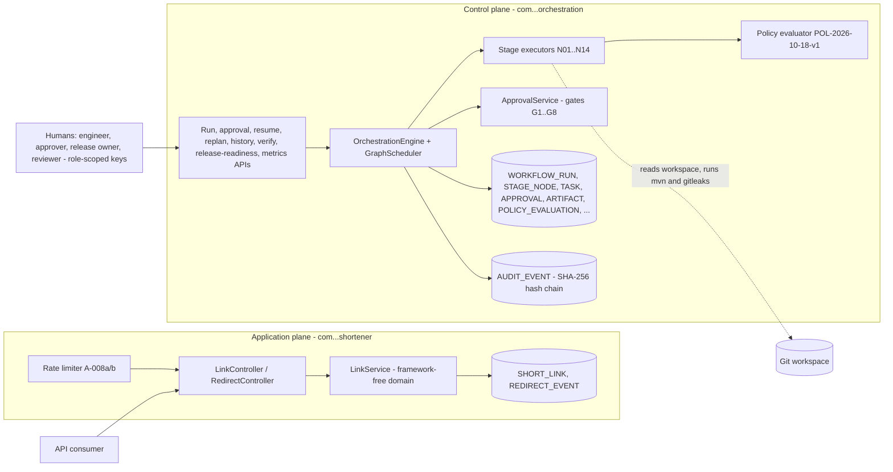
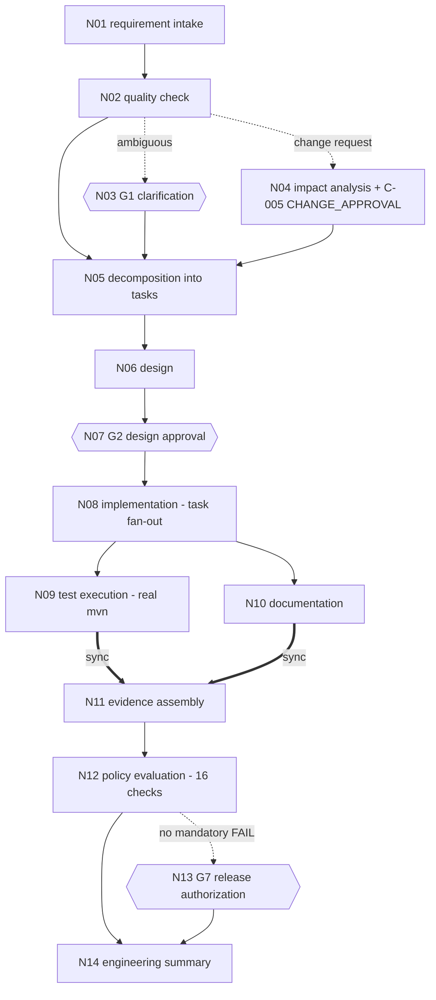

# Architecture Overview

One Spring Boot fat jar (Java 21, H2 in file mode), two strictly separated planes. Detailed design: `specs/001-agentic-url-shortener/plan.md`; decisions: `docs/adr/adrs.md` (ADR-001..009); data: `data-model.md`; API: `contracts/openapi.yaml`.

The application plane never depends on the control plane (ArchUnit rule; the shared kernel holds value objects and ports only). Cross-plane references are identifiers only.

## The SDLC stage graph (N01-N14)

Edge kinds (STAGE_EDGE): solid = DEPENDENCY, dotted = CONDITIONAL (the predecessor selects the branch; an unselected node is NOT_APPLICABLE with the reason recorded), double = SYNC (wait for all). Hexagons are human gates. Gates without a stage node: G3 security-sensitive, G4 destructive, G5 policy exception, G6 accepted limitation, G8 final submission, plus REPLAN_ACCEPTANCE and CHANGE_APPROVAL (role mapping in ADR-008: APPROVER for G1-G4, replan and change approval; RELEASE_OWNER for G5-G8; the approver's key must differ from the requester's).

## How a run executes

1. `POST /runs` (ENGINEER) stores the requirement (N01) and starts the run off the request thread.
2. The engine dispatches every node whose predecessors are satisfied to a bounded pool, so independent branches run in parallel; every node and run transition is persisted with an optimistic lock and an audit event in one transaction (ADR-005).
3. A gate node requests its approval and the run waits (AWAITING_APPROVAL or SUSPENDED_CLARIFICATION). A human decision through the approvals endpoint resumes it; silence escalates once and then safe-stops the path.
4. Failures are classified: transient ones retry (at most 3, backoff 1/2/4 s, 60 s bound), a recorded fallback runs after a permanent failure, anything else safe-stops the run with a recorded cause. Uncommitted rows roll back; committed code is compensated by a revert commit.
5. N12 evaluates 16 checks on real evidence (tests the run executed, gitleaks, inventory and license checks, chain verification, approval and replan records, the traceability checker, signed attestations). A mandatory FAIL records NOT_READY and the release gate is never offered.
6. The run completes only when the FR-044 completion gate finds evidence for all ten Constitution XI conditions; N14 writes the engineering summary; the chain is re-verified and the result appended as the last event.
7. On restart, runs found mid-flight are safe-stopped (BOOT_RECOVERY), pending operations are reconciled by effect verification, and only an authorized `POST /resume` continues them.

## What is agentic and what is human

The runtime executors are deterministic, rule-based agents with bounded autonomy (a per-node operation whitelist, enforced): they check requirement quality, scan the workspace for impact, decompose into tasks, assemble designs, documentation and evidence, run the test suites, evaluate policy and write the summary. They call no language model at runtime. Design text and code are produced by the engineer with AI assistance (Claude Code) outside the runtime and enter the run as versioned artifacts: N08 accepts an implementation only as a workspace commit marked `[run <id> task <key>]`. Humans decide every gate. This split is the plan's executor model (plan section 3, "Agent executor model"), chosen so that every step is reproducible and auditable.

## Testing approach

Test-first throughout (red test committed before the implementation; `docs/evidence/red-first-audit.md`). `mvn clean verify` runs Surefire `*Test` and Failsafe `*IT`: domain unit tests, contract tests validated against `openapi.yaml` (swagger-request-validator), persistence and integration tests on H2 file mode, orchestration transition tests, approval, retry, fallback, rollback and compensation tests, kill-and-restart on the real jar, concurrency (PVT-003), performance (PVT-001/002), security (URL rejection matrix, rate limits, roles), ArchUnit plane and purity rules, and end-to-end tests. Demonstration runs add live evidence (`docs/evidence/`).

## Trade-offs (from the ADRs)

| Decision | Chosen | Traded away |
|---|---|---|
| Runtime and framework (ADR-001/002) | Java 21, Spring Boot 3.5 | Spring Boot 3.5 is past open-source support; upgrade path Boot 4 under change control |
| Persistence (ADR-003) | H2 file mode behind repositories, Spring JDBC | Not a production database; no multi-instance deployment; PostgreSQL path documented, not tested |
| Run model (ADR-004) | One fat jar, one module | Simple to run and to kill-and-restart; both planes scale together |
| Workflow state and audit (ADR-005) | Relational tables, transactional hash chain | Detects tampering, does not prevent it (A-011) |
| Orchestration (ADR-007) | Explicit persisted graph, governed replanning | Fixed 14-stage graph; staged revisions deferred (L-SC-03) |
| Approvals and auth (ADR-008) | Role-scoped API keys, distinct approver identity | One person may hold several keys (procedural control); per-key rate limits deferred (L-SC-01) |
| Failure semantics (ADR-009) | Bounded retry, fallback, safe-stop, rollback vs compensation | Rework cycles deferred (L-SC-04) |

## Limitations

The accepted limitations (individually approved at G6, `docs/evidence/t093-accepted-limitations.md`) and the deferred scope are listed in `docs/scope-control.md` and summarized in the README's "Honest limits".
